# Rally de la Independencia AR

Juego de realidad aumentada para recorrer Dolores Hidalgo, desarrollado con **Flutter** siguiendo **TDD** (Test-Driven Development).

- **Materia:** Desarrollo Móvil Integral · UTNG
- **Profesor:** Anastacio Rodríguez García
- **Alumno(s):** Esaú Rafael Guzmán Almaguer

## ¿De qué trata?

El jugador camina por el Jardín Principal buscando 6 personajes de la Independencia escondidos al azar. Un radar y un indicador de "frío o caliente" lo guían. Al estar a 15 m o menos, toca al personaje y responde una pregunta de historia para atraparlo y guardarlo en su álbum.

| Regla | Valor |
|---|---|
| Personajes | 6 |
| Distancia de aparición | 60 a 500 m del Jardín Principal |
| Radio de captura | 15 m |
| Intentos | 2 (con 2 fallos el personaje huye y reaparece en otro lugar) |
| Puntos | 100 al primer intento, 50 al segundo |

## Estructura del proyecto

```
lib/
  dominio/        reglas del juego (Dart puro)
  datos/          GPS, brújula, simuladores y almacenamiento
  presentacion/   ViewModel y pantallas
  main.dart
test/             6 archivos de prueba, 43 pruebas
capturas/         evidencias del README
```

## Cómo ejecutarlo

```bash
flutter pub get
flutter test      # corre las 43 pruebas
flutter run       # modo demo disponible sin salir del salón
```

---

## Evidencias del ciclo TDD (🔴 rojo → 🟢 verde)

En cada ronda se quitó temporalmente el código para ver la prueba **fallar** (rojo) y se restauró para verla **pasar** (verde).

### Ronda 2 · Geometría (`geo_test.dart`, 7 pruebas)

| 🔴 Rojo | 🟢 Verde |
|---|---|
| 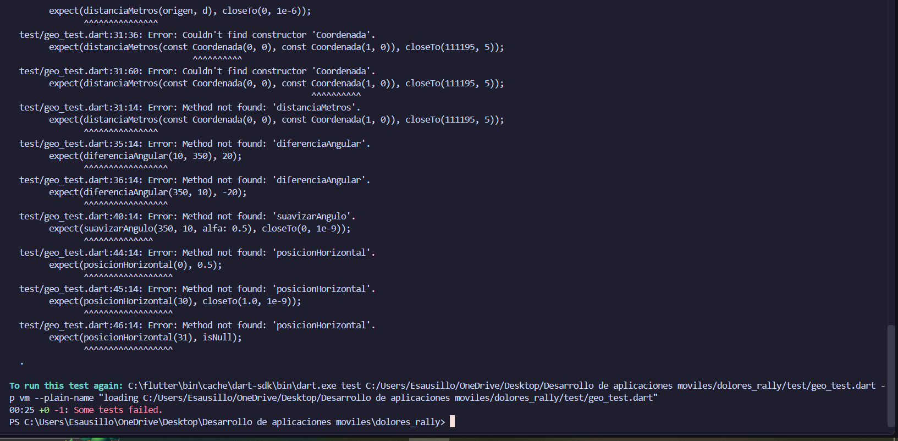 | 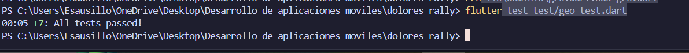 |

### Ronda 4 · Azar con semilla (`aparicion_test.dart`, 5 pruebas)

| 🔴 Rojo | 🟢 Verde |
|---|---|
| 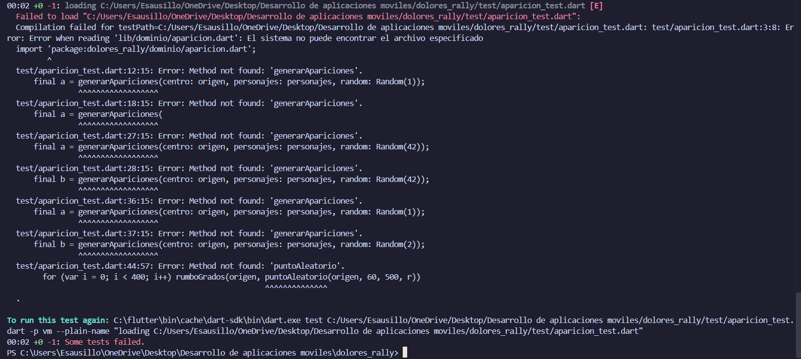 | 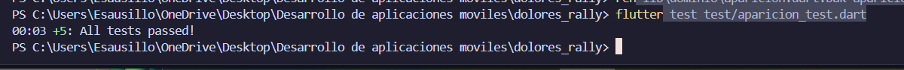 |

### Ronda 5 · Radar y frío o caliente (`radar_test.dart`, 7 pruebas)

| 🔴 Rojo | 🟢 Verde |
|---|---|
| 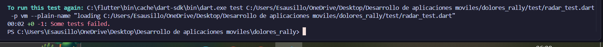 | 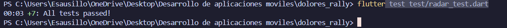 |

### Ronda 6 · Motor de realidad aumentada (`motor_ar_test.dart`, 5 pruebas)

| 🔴 Rojo | 🟢 Verde |
|---|---|
| 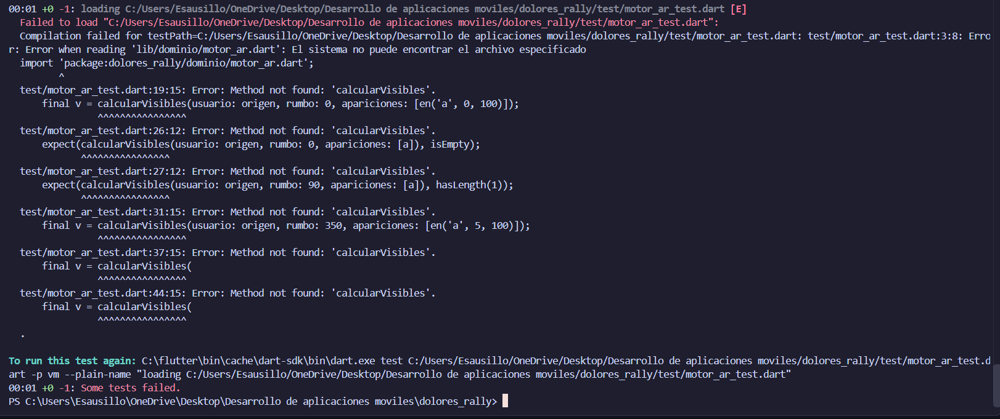 | 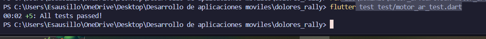 |

### Ronda 7 · Reglas del juego (`partida_test.dart`, 10 pruebas)

| 🔴 Rojo | 🟢 Verde |
|---|---|
| 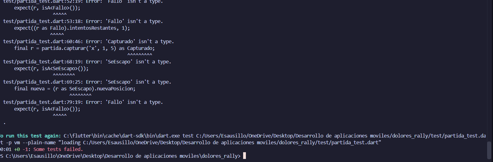 | 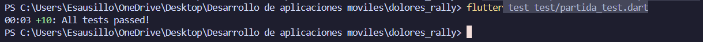 |

### Ronda 10 · ViewModel (`rally_viewmodel_test.dart`, 9 pruebas)

| 🔴 Rojo | 🟢 Verde |
|---|---|
| 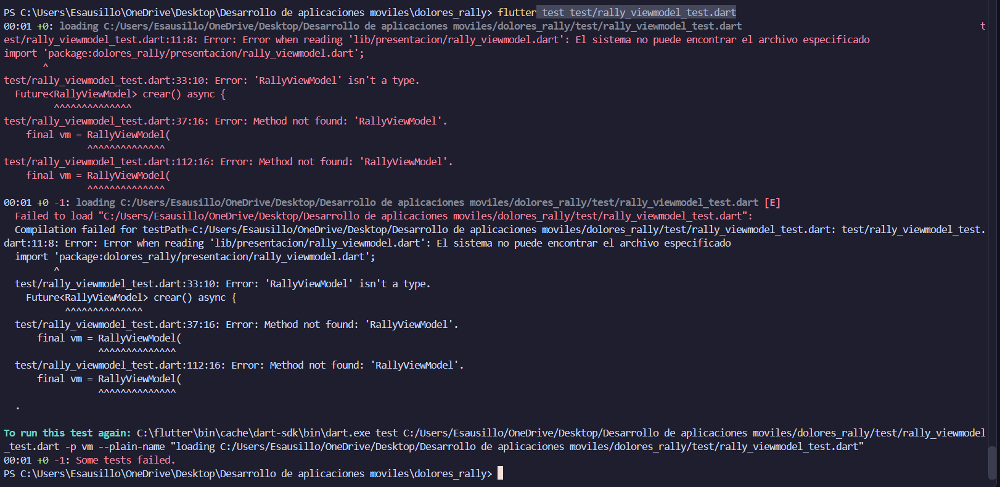 | 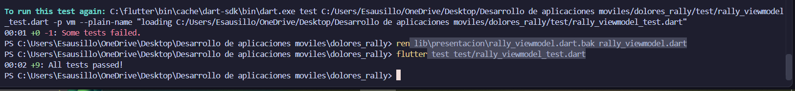 |

### Suite completa

43 pruebas en verde:

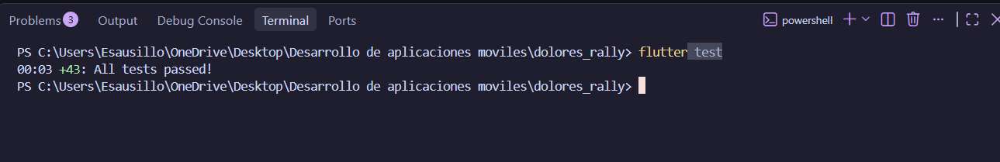

---

## Capturas del juego (modo demo)

### 1. Pantalla de inicio
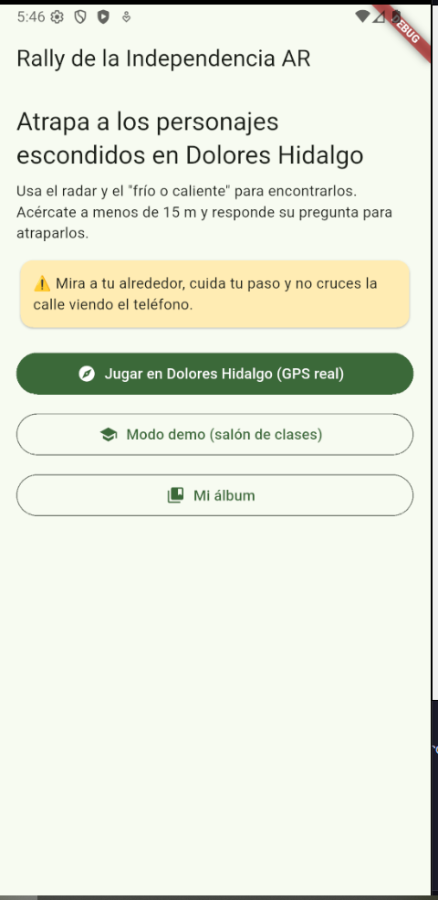

### 2. Radar con el letrero "🥶 Helado"
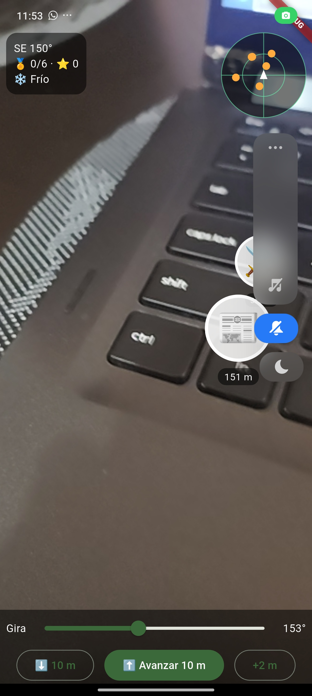

### 3. Personaje en realidad aumentada
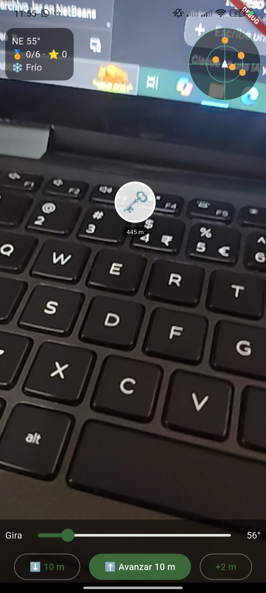

### 4. Acercándose: "🔥 Caliente"
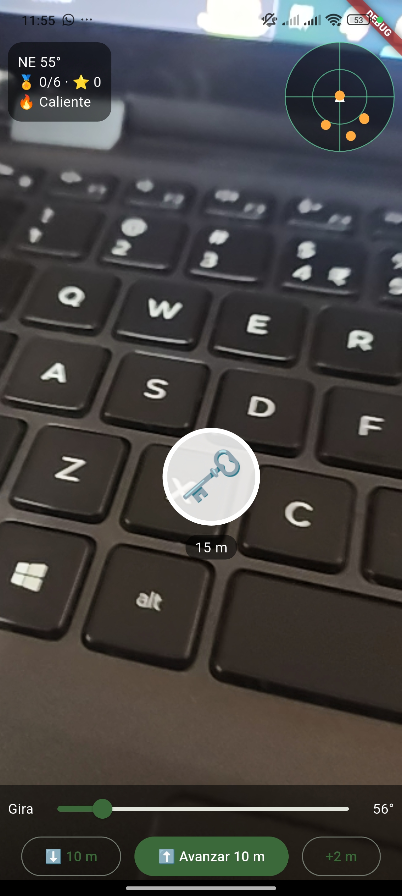

### 5. A 15 m o menos: "¡Tócame!"
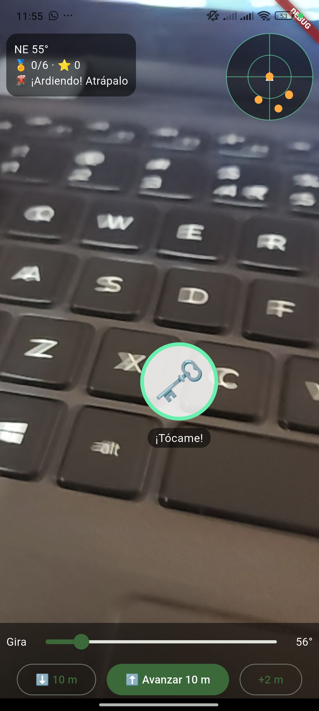

### 6. Pregunta de historia
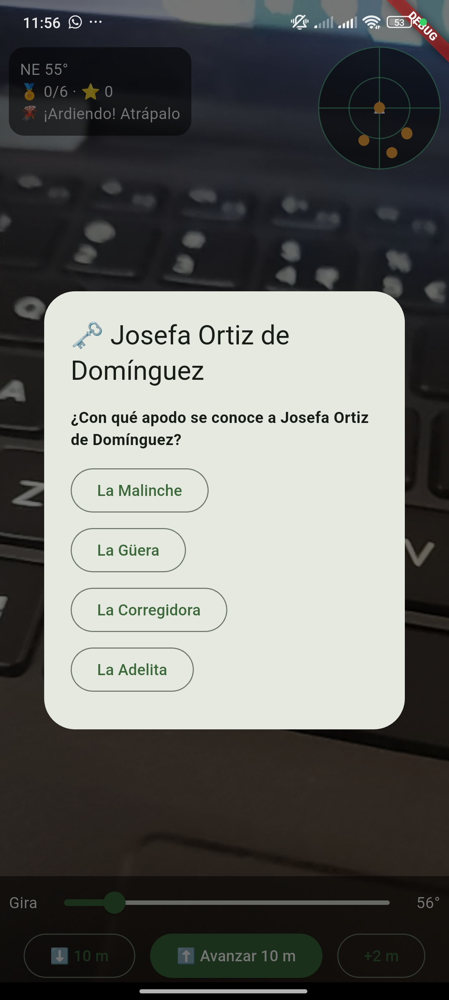

### 7. Dos fallos: el personaje huye
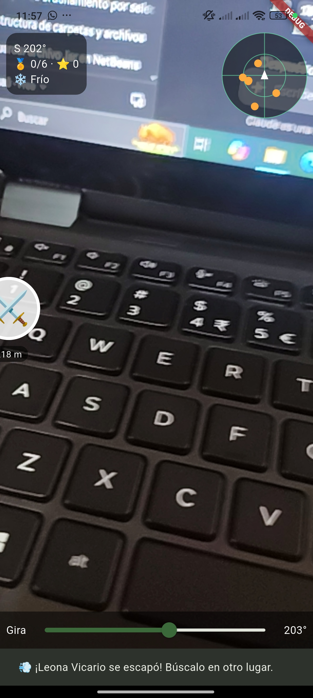

### 8. Álbum de personajes
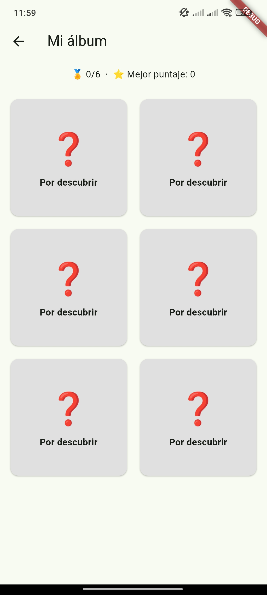

---

## Datos históricos

Los datos del catálogo y las coordenadas son de práctica. Deben verificarse con fuentes históricas locales antes de usar el juego con alumnos.