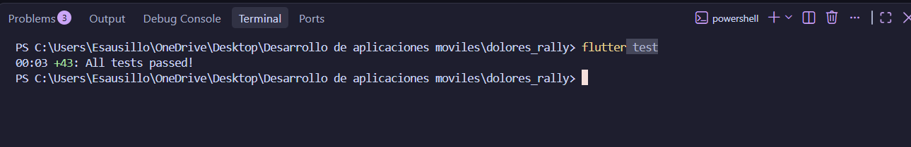
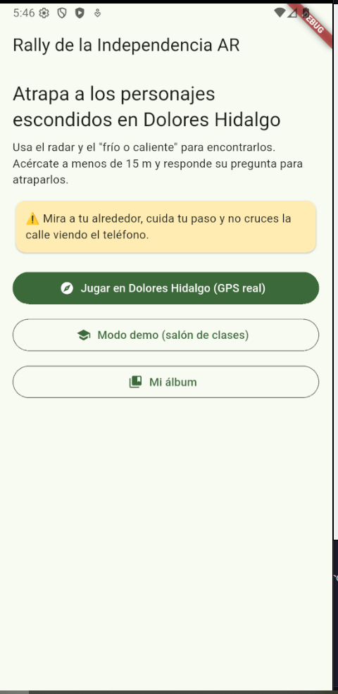
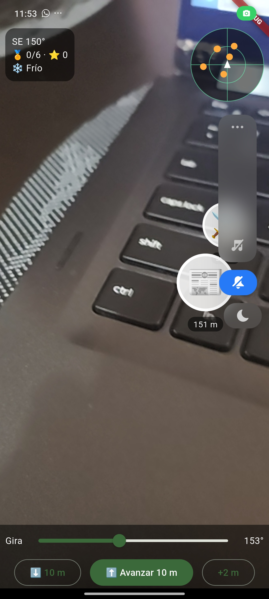
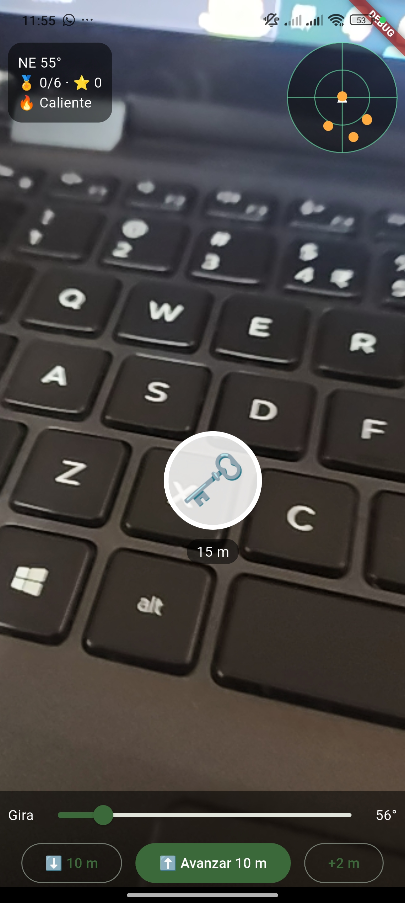
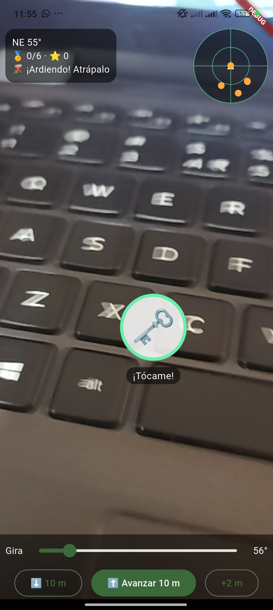
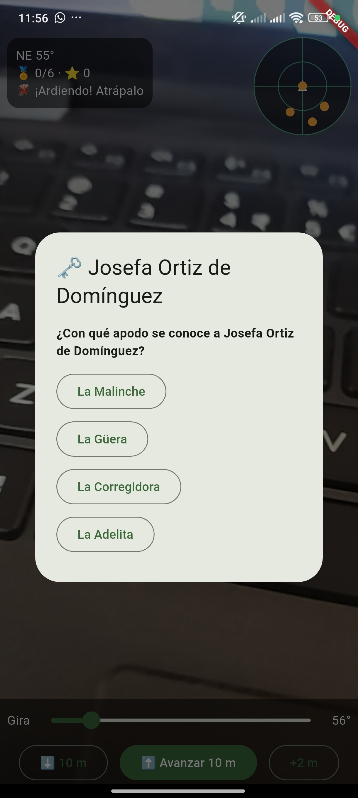
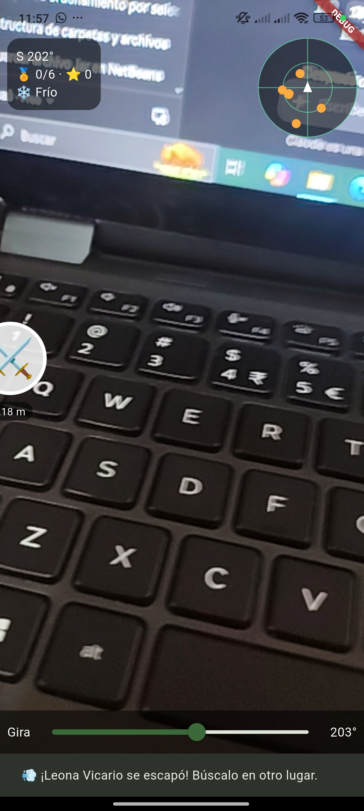
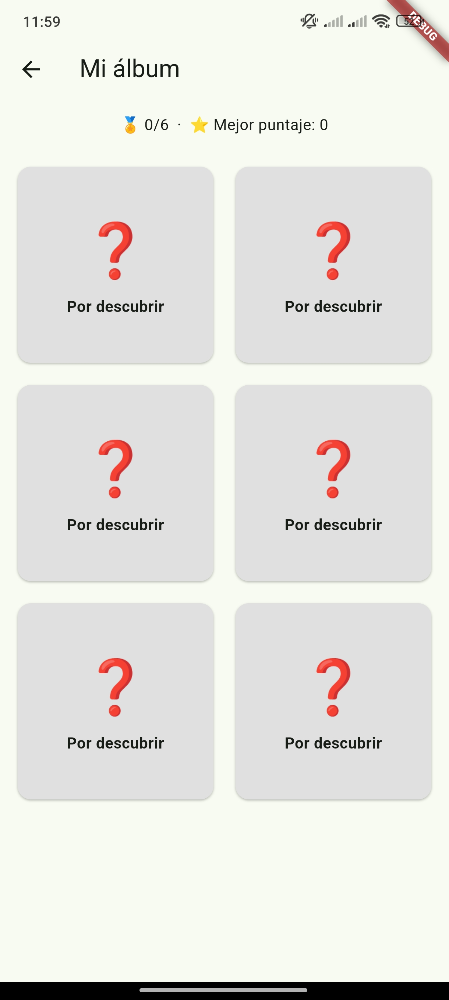

# Rally de la Independencia AR · Dolores Hidalgo

Juego de realidad aumentada basado en ubicación para recorrer Dolores Hidalgo: radar, "frío o caliente", trivia histórica, álbum coleccionable y modo demo. Desarrollado con TDD en Flutter.

**Materia:** Desarrollo Móvil Integral · UTNG
**Profesor:** Anastacio Rodríguez García
**Alumno(s):** _(tu nombre / equipo)_

---

## Cómo correrlo

```bash
flutter pub get
flutter test
flutter run
```

Para jugar sin salir del salón: en la pantalla de inicio toca **"Modo demo (salón de clases)"**.

## Estructura

```text
lib/
  dominio/        reglas del juego (Dart puro)
  datos/          GPS, brújula, simuladores y almacenamiento
  presentacion/   ViewModel y pantallas
  main.dart
test/             pruebas TDD
capturas/         evidencias de este README
```

---

## Capturas

> Guarda cada imagen en la carpeta `capturas/` con **exactamente** estos nombres para que se vean aquí.

### 1. Pruebas pasando (TDD)
Resultado de `flutter test` con todas las pruebas en verde.



### 2. Pantalla de inicio
Con el aviso de seguridad física visible y los botones de jugar, modo demo y álbum.



### 3. Radar y temperatura "Helado"
Inicio de la partida en modo demo: puntos naranjas en el radar y letrero 🥶.



### 4. Personaje en realidad aumentada
Un personaje flotando sobre la cámara con su distancia.


### 5. Temperatura "Caliente"
Después de usar "Avanzar 10 m" varias veces, el letrero se calienta.



### 6. Círculo verde "¡Tócame!"
A 15 m o menos del personaje.



### 7. Pregunta de historia
Pantalla de trivia al tocar al personaje.



### 8. Personaje que huye
Después de fallar dos veces, el personaje reaparece lejos.



### 9. Álbum de personajes
Con los personajes capturados.



---

## Reglas del juego

- Se atrapa a un personaje estando a **15 m o menos**.
- Se captura respondiendo bien una pregunta: **100 puntos** al primer intento, **50** al segundo.
- Con **2 fallos** el personaje huye y reaparece en otro lugar.
- Los personajes aparecen entre **60 y 500 m** del Jardín Principal.
- Temperatura: Ardiente ≤ 15 m · Caliente ≤ 50 m · Tibio ≤ 150 m · Frío ≤ 400 m · Helado más lejos.

## Aviso

Los datos históricos y coordenadas son de práctica; verifícalos con fuentes locales antes de usarlos con alumnos. Juega en grupo y con la vista en el entorno, lejos de calles y obras.